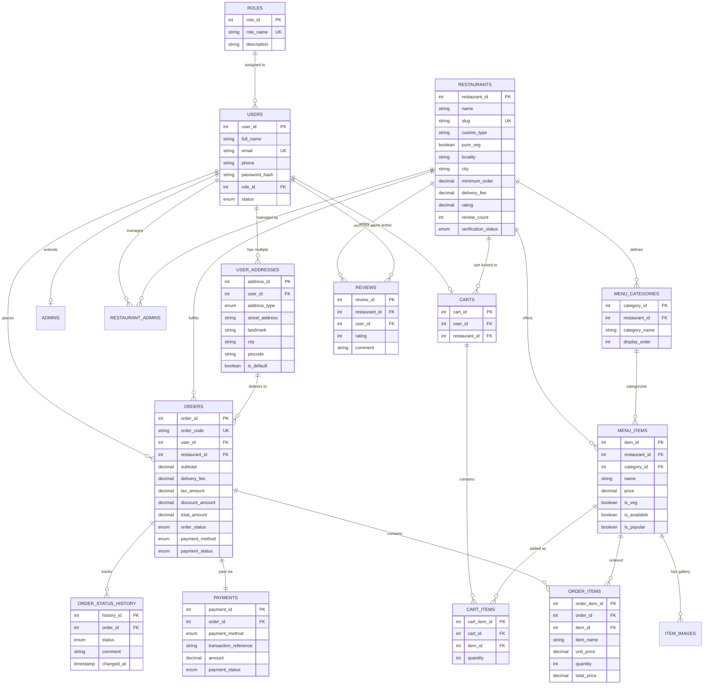

# BHOOKH — MySQL Workbench 8.0 EER Diagram & Database Architecture Guide

This document provides a comprehensive guide for importing, managing, and demonstrating the **BHOOKH** relational database in **MySQL Workbench 8.0**.

---

## 1. Quick Project Specifications
- **Application Name**: BHOOKH
- **Database Name**: `bHOOKH_db`
- **Database Engine**: MySQL 8.0 (InnoDB, utf8mb4)
- **Primary SQL Script**: `database/bHOOKH_db.sql`
- **Total Relational Tables**: 17 normalized tables (3NF/BCNF)
- **Restaurants Seeded**: 8 Outlets (1 Real Verified: Flora Café; 7 Curated Fictional: The Urban Fork, Brew & Bean, Spice Theory, Seoul Street, Green Bowl Co., The Burger District, Oven Stories Café)
- **Views**: 3 Analytical Views (`view_restaurant_analytics`, `view_order_summary`, `view_customer_spending`)
- **Triggers**: 2 Active Triggers (`trg_after_review_insert`, `trg_after_order_status_update`)

---

## 2. Step-by-Step Instructions: Import & Run in MySQL Workbench 8.0

### Step 1: Launch MySQL Workbench
1. Open **MySQL Workbench 8.0** from your Windows Start Menu or Desktop.
2. Under **MySQL Connections**, click on your local connection (e.g., `Local instance MySQL80` or `localhost:3306`).
3. Enter your MySQL `root` password if prompted.

### Step 2: Open the SQL Script
1. Go to the top menu: **File** → **Open SQL Script...** (or press `Ctrl + Shift + O`).
2. Navigate to:
   ```
   C:\Users\hp\.gemini\antigravity\scratch\bhookh\database\bHOOKH_db.sql
   ```
3. Click **Open**.

### Step 3: Execute the Script
1. Click the **Execute (Lightning Bolt ⚡)** button on the SQL query toolbar (or press `Ctrl + Shift + Enter`).
2. Look at the **Action Output** pane at the bottom:
   - All statements will execute with green checkmarks.
   - The database `bHOOKH_db` is created.
   - All 17 tables, foreign key constraints, indexes, triggers, views, and seed rows are inserted.
3. In the left **Navigator** panel under **Schemas**, right-click and choose **Refresh All**. You will see `bHOOKH_db` listed with its Tables, Views, and Stored Procedures!

---

## 3. How to Generate the Visual EER Diagram in MySQL Workbench

MySQL Workbench can automatically reverse-engineer the database into a visual Entity-Relationship (EER) diagram with gold keys for Primary Keys, red connectors for Foreign Keys, and crow's foot cardinalities:

1. In MySQL Workbench top menu, select: **Database** → **Reverse Engineer...** (Shortcut: `Ctrl + R`).
2. Keep your connection (`Stored Connection: Local instance MySQL80`) selected and click **Next**.
3. Workbench connects to the server and retrieves tasks. Click **Next**.
4. In the database list, check the box next to **`bHOOKH_db`** and click **Next**.
5. Ensure **Import MySQL Table Objects** is checked (all 17 tables selected), then click **Execute**.
6. Once the objects are placed on the canvas, click **Next** → **Finish**.
7. An **EER Diagram tab** titled `bHOOKH_db - EER Diagram` will open on the canvas!
8. **Organize the layout**:
   - Go to menu: **Model** → **Arrange Objects** (or drag tables into logical clusters: *Users & Auth*, *Restaurants & Menus*, *Cart & Orders*, *Payments & Reviews*).
9. **Export for College Submission / Reports**:
   - Menu: **File** → **Export** → **Export as Single Page PDF...** or **Export as PNG...**.

---

## 4. Visual Schema Representation (Mermaid EER)



---

## 5. College Demonstration Checklist

During your project viva or evaluation, showcase the following:

1. **Table Normalization**: Show how `restaurants`, `menu_categories`, and `menu_items` prevent duplicate data.
2. **Single-Restaurant Cart Enforcement**: Show `carts` table with `restaurant_id` foreign key ensuring cart isolation.
3. **Price Integrity**: Show `order_items` storing `unit_price` and `total_price` captured at the time of order placement.
4. **Triggers in Action**: Show `trg_after_review_insert` updating the restaurant's rating and review count automatically when a new review is added.
5. **Audit Trail**: Show `order_status_history` logging transitions from *Order Placed* → *Confirmed* → *Preparing* → *Out for Delivery* → *Delivered*.
6. **Views Demonstration**: Query `view_restaurant_analytics` and `view_order_summary` to show instant reporting.
